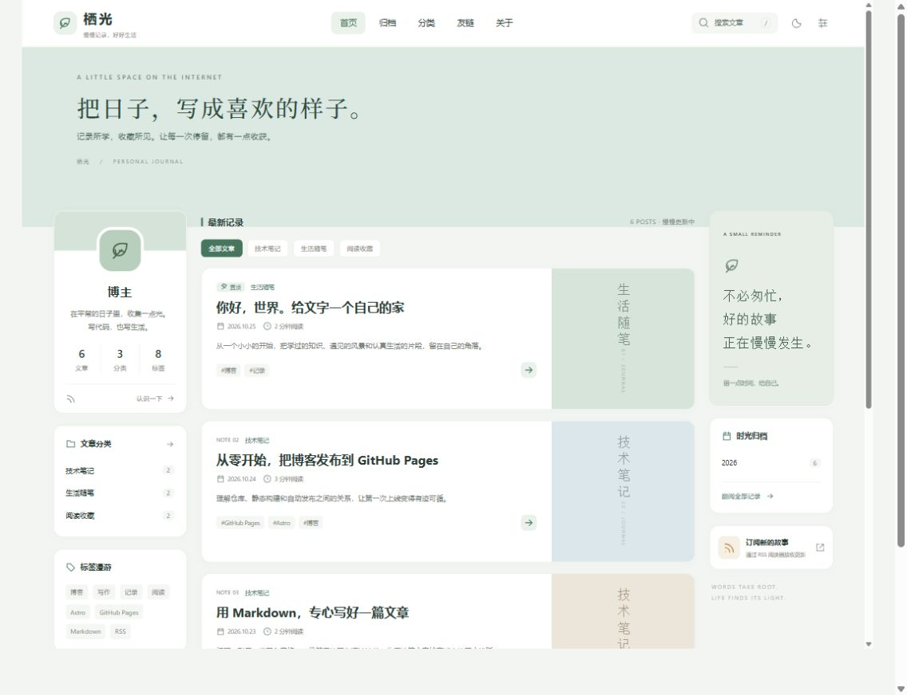
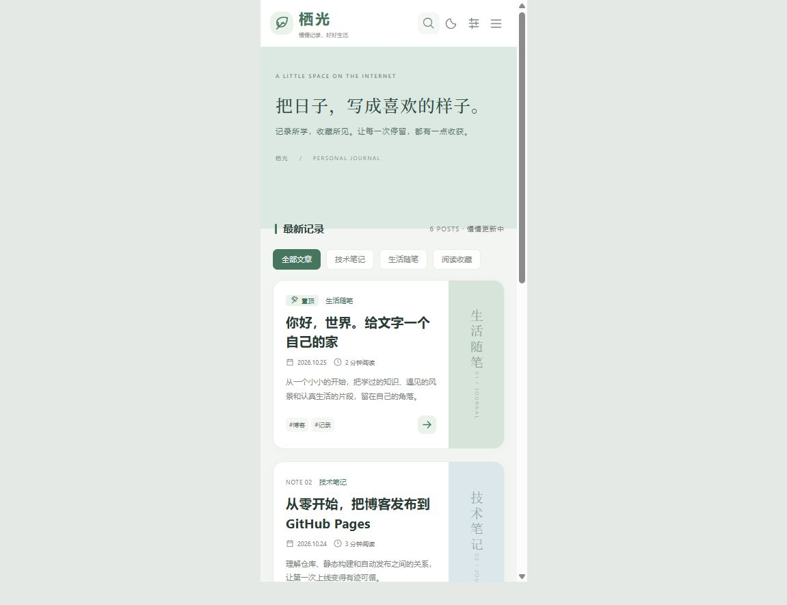

# 本次交付验证记录

> 初版历史记录，保留以便追溯。当前已改为具野 · Elio、三篇示例及 Supabase 后端；最新状态请读 07-Elio个性化与后端验证.md。

日期：2026-10-25。项目目录：`D:\grade3\web`。

## 环境与依赖

- Windows，Node.js `24.19.0`，npm `11.17.0`。
- Astro 最终锁定版本 `5.18.2`，具体传递依赖以 `package-lock.json` 为准。
- 项目 `.npmrc` 使用 npm 官方 registry。
- 已通过 `npm ci` 从锁文件完整重装依赖。

## 已实际完成的验证

| 项目 | 结果 |
| --- | --- |
| Astro / TypeScript 检查 | 33 个源文件，0 errors、0 warnings、0 hints |
| 根路径静态构建 | 26 个 HTML 页面，6 篇公开文章 |
| 站内链接与资源 | 1363 条检查通过，包括目录锚点、样式、脚本和搜索结果路径 |
| RSS 与 sitemap | 与实际公开文章一致，草稿未生成 |
| `/blog/` 子路径构建 | 构建与全部链接前缀检查通过 |
| 搜索算法 | 6 项行为测试全部通过 |
| 新建文章命令 | 可创建中文标题草稿，同名文件拒绝覆盖 |
| 部署地址准备脚本 | 用户主页仓库、普通项目仓库、自定义域名三种配置通过；自定义域名正确生成 CNAME |
| 浏览器首页 | 检查了实际排版和真实文章链接 |
| 浏览器搜索 | 搜索正文中的 DNS，得到发布教程，结果指向真实文章 |
| 阅读偏好 | 浅色切换到深色、苔绿切换到雾蓝均生效；已恢复默认设置 |
| 文章目录 | 可展开，点击代码示例跳到相应标题，URL 包含真实锚点 |
| 代码复制 | 点击后浏览器 Clipboard API 成功，并显示成功提示 |
| 窄屏布局 | 在 390 CSS px 的 iframe 视口检查首页；菜单可展开，分类链接能打开实际分类页 |
| 桌面布局 | 在 1440 CSS px 的 iframe 视口检查双侧栏 |

预览图：

## 当前验证边界

- 尚未收到真实 GitHub 用户名、仓库和域名，因此没有创建远程仓库、执行账号下的真实 Actions 发布、修改 DNS 或验证正式 HTTPS。
- 视口检查基于本地浏览器，不等同于已经在真实手机和所有浏览器上测试。
- 只有在实际服务配置好后才考虑加入评论等扩展功能；当前没有这些入口。
- 预览与测试用的页面不进入正式网站产物。

继续工作时优先读取根目录的 `休息后先看.md` 与 `site.config.mjs`，不需要重新创建项目。
