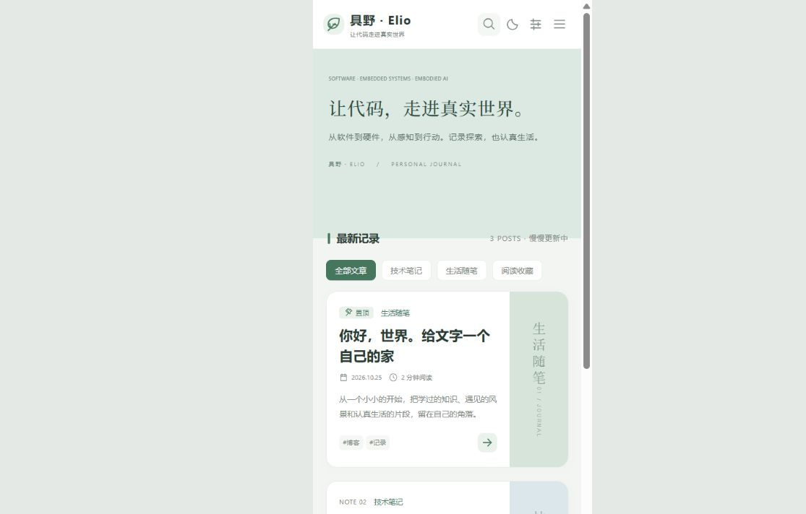
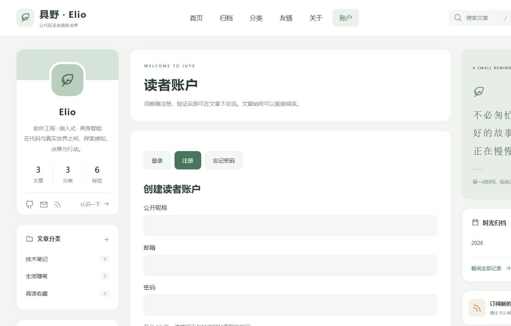

# Elio 个性化与后端验证

更新日期：2026-10-25。本文件替代初版 05 文档中的当前状态。

## 本次更改

- 博客名称：具野 · Elio；副标题：让代码走进真实世界。
- 正式域名选择：jy.遮阳帽.space，ASCII 形式 jy.xn--wut303ivvd.space。
- 昵称 Elio，GitHub Trouble-dealer，公开邮箱 elio.ashling@gmail.com。
- 关于页介绍软件工程、嵌入式与具身智能的学习探索，不虚构职业资历或项目成果。
- 三个栏目各保留一篇示例。未生成多余分页，标签、统计、搜索和 RSS 同步收敛为三篇。
- 使用用户确认的组织、新加坡区域创建真实 Supabase 项目 elio-jy-blog；项目创建报价为每月 $0，没有购买其他服务。
- 已应用两份数据库迁移和三篇文章登记，真实 REST 读取已验证。
- Gmail SMTP 是用户选定的后续发信方式；未接收或保存用户邮箱密码。

## 已通过的检查

| 检查 | 结果 |
| --- | --- |
| Astro / TypeScript | 43 个文件，0 错误、0 警告 |
| 静态构建 | 23 个 HTML 页面，3 篇公开文章 |
| 站内链接、资源与锚点 | 1096 条通过 |
| 搜索与数据库权限测试 | 15 项通过 |
| 本地真实 PostgreSQL | PGlite 运行实际迁移、触发器、列权限与 RLS；不是模拟前端响应 |
| 已验证身份限制 | 未验证邮箱被数据库拒绝；不存在的文章不能提交 |
| 评论隔离 | 游客只读已审核内容，用户额外可读自己的待审与拒绝内容 |
| 作者与审核权限 | 浏览器不能伪造作者、时间或审核状态，不能执行 UPDATE |
| 删除权限 | 其他用户删除影响 0 行，作者可以删除自己的评论 |
| 频率限制 | 删除评论也不能重置 30 秒 / 每小时 10 条限制，频率表对客户端不可见 |
| 公开 key 检查 | 禁止 sb_secret / service_role 被当作浏览器 key |
| 真实 Supabase REST | 三篇文章登记可读；comments 返回 HTTP 200，当前列表为空 |
| Supabase Security Advisors | 当前结果无检查项 |
| 浏览器首页 | 昵称、简介、三篇文章、分类计数与邮件 / GitHub 链接正确 |
| 浏览器评论 | 从真实后端加载为空，显示实际空状态；刷新按钮可用 |
| 临时开启账号界面 | 登录、注册、忘记密码切换正常，字段和必填约束可见；未冒充用户发送邮件 |

免费配额和邮件服务额度以平台当前政策为准，不能将 $0 项目报价视为无限资源承诺。

## 尚未完成的外部步骤

1. 用户创建 Trouble-dealer.github.io 仓库、上传代码并开启 Pages。
2. 用户在阿里云添加 jy CNAME，GitHub 设置 Custom domain 和 HTTPS。
3. Supabase Auth Site URL、Redirect URLs 和 Gmail SMTP。
4. 用户自己完成真实邮箱收信、PKCE 验证、找回密码、登录与评论审核全流程验收。

因此 community.config.mjs 的 emailReady 仍为 false，正式页面不展示无法完成发信的注册表单。临时开发环境的账户预览不代表邮件链路已经验收。

## 截图

以下为临时开发环境开启开关后的界面预览；正式开关仍关闭：

## 后端与职责

身份密码由 Supabase Auth 处理；评论表无邮箱与密码字段。内容写入经过服务端触发器、行级权限和列权限校验；显示使用 textContent，HTML 按纯文本处理。

账户只用于读者交流，无博客管理权限。审核通过 Supabase Table Editor 执行。新增文章后需要应用构建出的 seed-posts.sql，才开放该文章提交。真实发信验收参见第 06 份文档。

Supabase 性能检查曾提示新建索引未使用，这些索引用于文章分页、用户权限查询和频率限制，首次建库没有业务流量时保留。频率表主键与明确拒绝客户端的策略已补齐。
